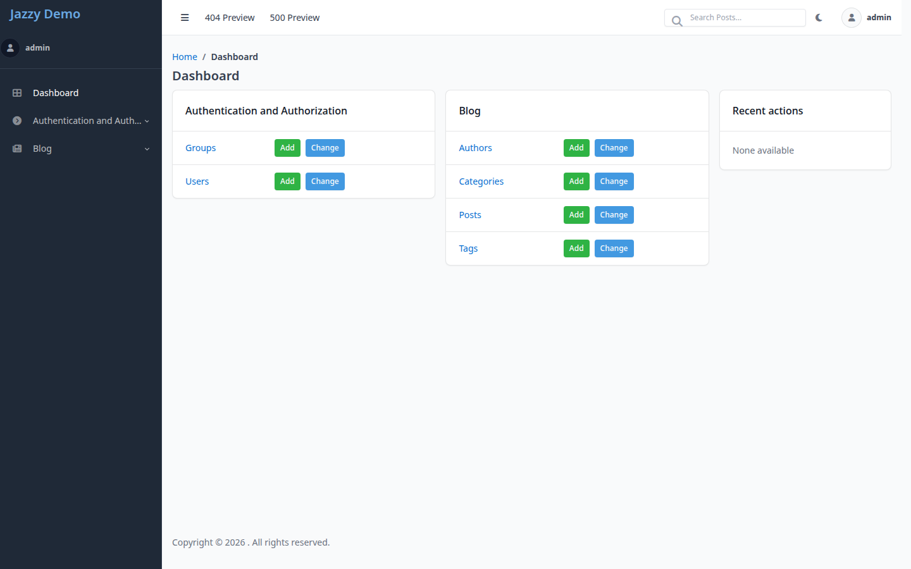
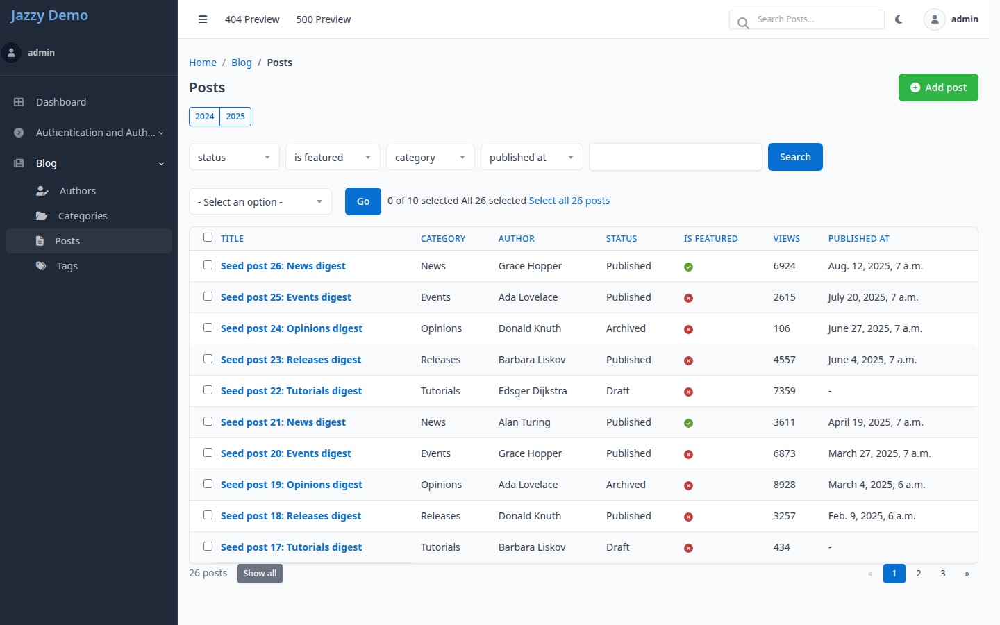
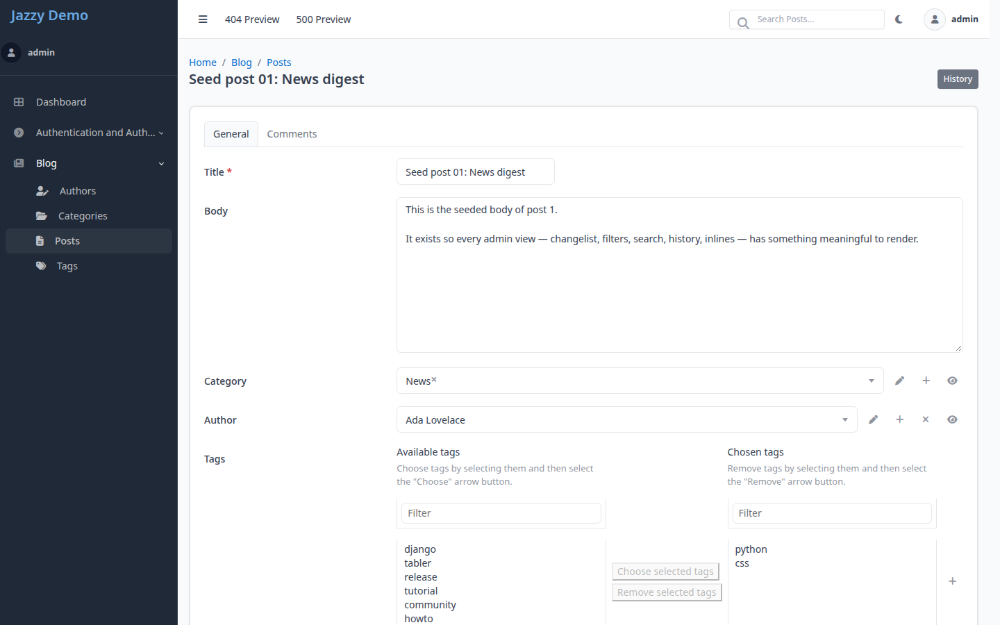
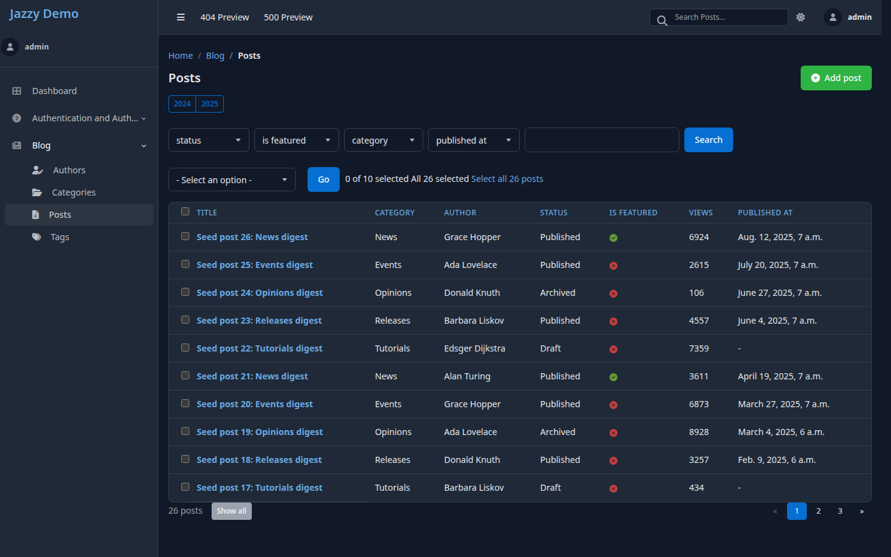
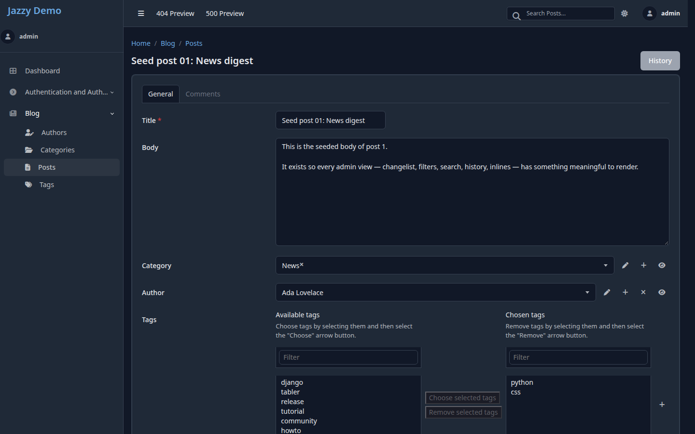

# django-jazzy-tabler

A drop-in Django admin theme based on [Tabler](https://tabler.io) (Bootstrap 5), inspired by [django-jazzmin](https://github.com/farridav/django-jazzmin).

Two lines in your settings and the stock admin gets a clean, modern skin — with first-class **light and dark mode**:

```python
INSTALLED_APPS = [
    "jazzy_tabler",
    "django.contrib.admin",
    # ...
]
```

No build step, no Node, no npm — everything ships as static files inside the wheel.

<picture>
  <source media="(prefers-color-scheme: dark)" srcset="https://raw.githubusercontent.com/RamezIssac/django-jazzy-tabler/main/docs/screenshots/dashboard-dark.png">
  
</picture>

> **Status:** alpha. The configuration surface is stable enough to use; templates may still shift between minor versions.

## Highlights

- **Drop-in.** Templates resolve ahead of `django.contrib.admin` — your `ModelAdmin`s stay untouched.
- **Light + dark, everywhere.** Every screen is themed through Tabler CSS variables — select2 dropdowns, autocomplete fields and the little FK add/change/view/delete icons included.
- **Changeform layouts.** `single`, `horizontal_tabs`, `vertical_tabs`, `carousel`, `collapsible` — globally or per model.
- **Skins.** Ten CSS-only skins named after chords and scales (`sus4`, `tritone`, `blue-note`, ...), set with `JAZZY_UI_TWEAKS["skin"]`, optionally switchable by each user from a palette menu. See [Skins](https://github.com/RamezIssac/django-jazzy-tabler/blob/main/docs/settings.md#skins).
- **Familiar configuration.** One optional `JAZZY_SETTINGS` dict; if you're coming from jazzmin, your `JAZZMIN_SETTINGS` is read as a fallback.
- **Tested against what you see.** The repo runs a URL-coverage suite (every admin page must render) plus an opt-in Playwright screenshot matrix over the whole admin, in both theme modes.

| Changelist | Change form |
|---|---|
|  |  |
|  |  |

## Quickstart

```bash
pip install django-jazzy-tabler   # or: uv add django-jazzy-tabler
```

then the `INSTALLED_APPS` snippet above — that's it, visit `/admin/`. Everything below is optional:

```python
# settings.py — all keys optional, all with sane defaults
JAZZY_SETTINGS = {
    "site_title": "Jazzy dashboard",
    "site_header": "Jazzy dashboard",
    "site_brand": "Jazzy dashboard",
    "welcome_sign": "Welcome back",
    "search_model": "blog.Post",
    "icons": {
        "auth": "fas fa-users-cog",
        "auth.user": "fas fa-user",
        "blog.post": "fas fa-newspaper",
    },
    "changeform_format": "horizontal_tabs",
}

JAZZY_UI_TWEAKS = {
    "navbar": "light",
    "sidebar": "dark",
    "default_theme_mode": "light",   # light | dark | auto
    "accent_color": "primary",       # any Tabler color name
    "skin": None,                    # or a skin name such as "sus4"
    "skin_chooser": False,           # palette menu to switch skins per user
}
```

📖 **Full settings reference — every honored key, the jazzmin fallback rules, menu/icon structures, changeform formats, copy-pasteable examples:**
[docs/settings.md](https://github.com/RamezIssac/django-jazzy-tabler/blob/main/docs/settings.md)

## Extending the top navbar

Apps can inject extra items into the top navbar (documentation links, status
badges, environment banners, ...) without copying `admin/base.html`:

- **Override the include** — ship `jazzy_tabler/includes/navbar_extra.html` in
  an app listed **before** `"jazzy_tabler"` in `INSTALLED_APPS`. The include is
  empty by default and renders in both the desktop top navbar and the mobile
  (`d-lg-none`) navbar.
- **Or extend the block** — extend `admin/base.html` and override
  `` (keep ``
  inside it if the mobile navbar should keep rendering the include).

Use Tabler navbar markup, e.g. `<div class="nav-item d-none d-md-flex me-3"><a class="btn btn-ghost-secondary" href="...">…</a></div>`;
spacing utilities like `me-3` are RTL-safe. See the comments in
`jazzy_tabler/templates/jazzy_tabler/includes/navbar_extra.html`.

## Extending the login form

`admin/login.html` has an empty `` above the submit button, for hints or a captcha
widget. Extend `admin/login.html` and point `admin.site.login_template` at your template.

## Compatibility

- Python 3.10+, Django 4.2+ (developed against the latest Django).
- Works with `autocomplete_fields`, `raw_id_fields`, `filter_horizontal`/`filter_vertical`, stacked + tabular inlines, and Django 4.1+ popup/related-object flows.

## Develop

The repo ships a `demo/` project and a two-layer test suite.

```bash
uv sync
uv run pytest                                        # fast suite: every admin URL must render

# demo server with seeded data (DEMO_SKIN=<name> sets the default skin)
uv run python manage.py migrate --run-syncdb
uv run python manage.py seed_demo --with-superuser   # admin / admin (DEMO_ADMIN_PASSWORD to override)
uv run python manage.py runserver                    # browse http://127.0.0.1:8000/admin/

# opt-in browser pass: screenshot matrix over the admin, light + dark
uv sync --group screenshots
uv run playwright install chromium                   # once
JAZZY_SCREENSHOTS=1 uv run pytest tests/test_screenshots.py
# -> proofs/<run>/index.html — grouped 4-column grid with a lightbox gallery

# publish the matrix as a GitHub Pages site (no CI needed)
scripts/publish-matrix-site.sh                       # local preview at proofs/site-preview/
scripts/publish-matrix-site.sh --push                # push the gh-pages branch
# then enable Pages once: repo Settings -> Pages -> Source: gh-pages, / root
# -> https://<owner>.github.io/django-jazzy-tabler/
```

## Credits

- [**Tabler**](https://tabler.io) — the beautiful open-source dashboard UI kit this theme is built on. ⭐ [Star it](https://github.com/tabler/tabler), 💛 [sponsor it](https://github.com/sponsors/codecalm).
- [django-jazzmin](https://github.com/farridav/django-jazzmin) — the inspiration for the configuration surface.
- [AdminLTE](https://adminlte.io) — the dashboard kit behind jazzmin's look.

And if jazzy-tabler saved you time: ⭐ star this repo — it helps others find the theme.

## License

MIT
